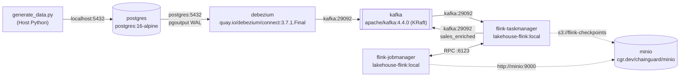

# System Architecture Specification

## 1. Topology Overview

The stack runs as a single Docker Compose project (`name: lakehouse`) on the default bridge network (`lakehouse_default`).

---

## 2. Service & Network Matrix

AI agents MUST distinguish between **container-to-container addresses** (used inside `docker-compose.yml`, Debezium configs, and Flink SQL) and **host addresses** (used by `generate_data.py` and host CLI checks):

| Service | Image | Internal Address | Host Port(s) | Credentials / Notes |
| :--- | :--- | :--- | :--- | :--- |
| `postgres` | `postgres:16-alpine` | `postgres:5432` | `localhost:5432` | DB: `lakehouse`, User/Pass: `postgres` / `postgres` |
| `kafka` | `apache/kafka:4.4.0` | `kafka:29092` | `localhost:9092` | KRaft (`broker,controller`), no ZooKeeper |
| `debezium` | `quay.io/debezium/connect:3.7.1.Final` | `debezium:8083` | `localhost:8083` | REST API for Kafka Connect |
| `minio` | `cgr.dev/chainguard/minio:latest` | `minio:9000` | `localhost:9000` (S3), `localhost:9001` (UI) | User/Pass: `admin` / `password123` |
| `flink-jobmanager` | `lakehouse-flink:local` (`flink:1.20.5-scala_2.12`) | `flink-jobmanager:8081` (REST), `:6123` (RPC) | `localhost:8081` | Session cluster coordinator |
| `flink-taskmanager` | `lakehouse-flink:local` (`flink:1.20.5-scala_2.12`) | internal | none | 4 task slots (`parallelism.default: 1`) |

---

## 3. Startup & Dependency DAG

One-shot initialization containers eliminate manual post-boot commands:

1. **Storage & Broker Layer**:
   - `postgres` boots with `wal_level=logical` and `max_slot_wal_keep_size=1GB` (capping retained slot WAL disk growth if Debezium goes offline), running `/docker-entrypoint-initdb.d/init.sql` on first volume initialization.
   - `kafka` boots in single-node KRaft mode (`KAFKA_LOG_CLEANER_ENABLE=true`, `KAFKA_LOG_RETENTION_CHECK_INTERVAL_MS=60000`). Once healthy, `kafka-init` creates all topics (`--if-not-exists`) and idempotently enforces per-topic retention/compaction policies via `kafka-configs.sh --alter`.
   - `minio` boots and passes `mc ready local`. Once healthy, `minio-init` creates `s3://flink-checkpoints`.
2. **CDC Ingestion Layer**:
   - `debezium` waits for `postgres` and `kafka` healthchecks, creating internal Kafka Connect topics (`connect_configs`, `connect_offsets`, `connect_statuses`).
   - `debezium-init` waits for `debezium` healthcheck and idempotently `PUT`s `/debezium/connector-config.json` (including 10s LSN heartbeats and batch/queue sizing) to `/connectors/postgres-lakehouse-connector/config`.
3. **Stream Processing Layer**:
   - `flink-jobmanager` and `flink-taskmanager` run with the **Embedded RocksDB** state backend (`state.backend.type: rocksdb`, `state.backend.incremental: true`), spilling join state to local disk and writing incremental checkpoints to `s3://flink-checkpoints/checkpoints`.
   - `flink-sql-submit` waits for `flink-jobmanager` (with $\ge 1$ available slot), `kafka-init`, and `debezium-init`, checks if `sales-cdc-enrichment` is already `RUNNING`, and if not, submits `/opt/flink/sql/job.sql`.

---

## 4. State & Persistence

Named Docker volumes persist state across container restarts (`docker compose restart` / `docker compose stop`):

- `postgres_data` $\rightarrow$ `/var/lib/postgresql/data`
- `kafka_data` $\rightarrow$ `/var/lib/kafka/data`
- `minio_data` $\rightarrow$ `/data`

> **Note**: `postgres/init.sql` is only executed by PostgreSQL when `postgres_data` is empty. Any schema migration during PoC development requires either `ALTER TABLE` against the running DB or a full reset via `docker compose down -v`.

---

## 5. Planned Evolution Path (Lakehouse Roadmap)

This PoC intentionally stops at **enriched Kafka topics + S3 checkpointing** to keep the baseline minimal. When extending toward a full Data Lakehouse:

- **Object Storage Reuse**: Reuse `minio` (e.g., create a `s3://warehouse` bucket via `minio-init`) for table formats.
- **Table Format & Catalog**: Add Apache Iceberg (with REST catalog such as Apache Polaris or Nessie) as an additional Flink sink reading either from the CDC sources (Bronze) or `sales_enriched` (Silver), keeping the existing CDC ingestion layer (`postgres` $\rightarrow$ `debezium` $\rightarrow$ `kafka`) unchanged.
- **Analytical Serving**: Query Iceberg tables on MinIO via DuckDB, Trino, or ClickHouse without coupling analytical queries to the OLTP `postgres` container.
